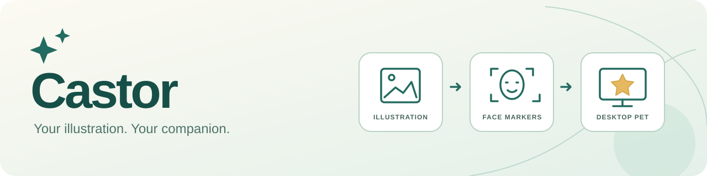
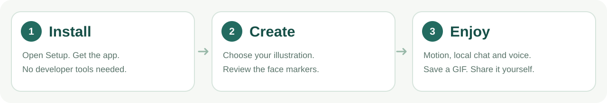

<p align="center"></p>

<p align="center"><b>English</b> | <a href="README.ja.md">日本語</a></p>

# Castor

**Turn your own illustration into a small companion that lives on your desktop.**

**This is a released version.** Get the latest build from [the latest Release](https://github.com/Methurcoder/Castor/releases/latest) or [castor.arils.jp](https://castor.arils.jp/).

It breathes, blinks, looks around and talks — and sometimes hesitates or looks away. You can make such a companion from a picture of your own.

[Download](https://github.com/Methurcoder/Castor/releases/latest) · [Setup guide (Japanese)](docs/GUI_SETUP.md) · [What's new (Releases)](https://github.com/Methurcoder/Castor/releases) · [Platform differences and plans (Japanese)](docs/CROSS_PLATFORM_PARITY.md)

Castor is the **authorized successor** to [Pomegranate](https://github.com/atemoyacode-sudo/Pomegranate). It keeps Pomegranate's copyright notice and MIT License, and is developed by Methurcoder.

Version names: fixes are released as v1.0.0 with a letter added, such as "Castor v1.0.0 (e)". Their tags look like `v1.0.0-e`. The Mac app's internal version is 1.0.2, told apart by build number. Only (a) and (b) are tagged `v1.0.1` and `v1.0.2`.

The app itself is available in Japanese and English. Most of the detailed documents in `docs/` are in Japanese for now.

## Download and install

From [the latest Release](https://github.com/Methurcoder/Castor/releases/latest), pick the file for your system (`…` in a file name is the version tag).

| Your system | File to download | What to open |
| --- | --- | --- |
| Mac / Apple Silicon (drag to install) | `Castor-…-macos_arm64.dmg` | Open it and drag Castor to Applications |
| Mac / Apple Silicon (update and repair app) | `CastorSetup-…-macos_arm64.zip` | `CastorSetup.app` |
| Windows / x64 | `CastorSetup-…-windows_x86_64.zip` | `CastorSetup.exe` |

**`Castor-Downloader.zip` is a script version that uses `.command` / `.cmd` files. To install with a window instead, choose the `CastorSetup-…zip` for your system above.**

Castor runs on **macOS 26.5 or later on Apple Silicon** and on **Windows x64**. Intel Macs are not supported in this release.

In the setup app, choose **Download / Update**, then **Launch**. The app and the runtimes it needs are included, so you don't need to install Xcode, Swift, Visual Studio or Python, or type any commands. Conversation needs LM Studio or Ollama if you want it, and acting on your computer needs the agent of your choice installed and signed in.

### First launch

- **Mac**: the app is signed for development (ad-hoc) and is not yet signed with a Developer ID or notarized. If macOS stops it the first time, allow it yourself in **System Settings → Privacy & Security → Open Anyway**. This is needed once each for the setup app, Castor and the Qwen helper.
- **Windows**: the app is not code-signed yet. If SmartScreen stops it, see the [setup guide (Japanese)](docs/GUI_SETUP.md).
- SHA-256 checks catch damaged downloads. They don't prove who published the file. See [protections and limits (Japanese)](docs/DOWNLOADER.md#アプリ取得時の保護と限界).

## Three steps to start



1. **Load your illustration**: in Rigging, choose one front-facing picture, or a front and a side view.
2. **Check the face**: adjust the markers for the head, both eyes and the mouth, then make and save the character. How well the face is estimated depends on the picture.
3. **Put it on your desktop**: choose its voice and personality, and enjoy its breathing, blinking, gaze and reactions when you gently touch it.

The image above shows the flow only. See below for what each platform supports and what has been checked.

## Features and status

| Feature | Mac | Windows |
| --- | --- | --- |
| Make a character from a picture, adjust face markers, save and load | One picture with Arils, or two pictures with Quality | Standard characters in a Mac-like creation window (Japanese and English), with the same face estimation and cut-out models as the Mac (ONNX). Quality uses the older window. Awaiting checks on real devices |
| Breathing, blinking, gaze, lip sync, reactions to petting | Done | Shared motion and CPU drawing done. Awaiting GUI checks on real devices |
| Conversation and personality with LM Studio / Ollama | Done | Done. Awaiting conversation checks on real devices |
| System voice, optional Qwen 3 TTS | Starting the Qwen helper, preparing the model, previewing and stopping checked on a real Mac | CPU helper included. Awaiting checks of real speech on real devices |
| Codex / Claude Code with approval for each action | Done. Nothing is sent out without your confirmation | Shared connection and approval UI done. Awaiting checks with real accounts |
| Making GIFs, saving them and sharing to X | Done | Done. Awaiting checks on real devices |
| Camera, extra ML, all Advanced settings | Optional permissions / helpers | Partly unsupported. Porting ML and improving quality come next |

**Each [Release](https://github.com/Methurcoder/Castor/releases) lists its changes and what was checked.** You can also read them in the setup app's update history. Not every feature has been confirmed to work equally well on both platforms. Windows GUI checks on real devices, downloading a new Qwen model, first installs on machines without developer tools, and long runs are still partly unchecked. Early fixes are recorded in the [fix log (Japanese)](docs/BUGFIX_REVIEW_2026-10-15.md).

### Plans

- **Linux**: native desktop support. Only the shared logic and CPU drawing are in development now; Linux is not part of this release.
- **Windows (WinUI 3)**: moving the creation window to native WinUI 3. It currently shows a Mac-like window in WebView2.
- **A larger shared engine**: less code per platform, more shared between Mac, Windows and Linux.

## Using Qwen 3 TTS

1. On the Mac, press **Settings → Voice → Load**. On Windows, open the helper's setup from Voice, then press **Load** in the helper.
2. Opening Settings alone never downloads or loads the model. The first download needs time and free space.
3. Play a sample in the voice selection window.

Starting the helper doesn't download the model, and the system voice works until the model is ready. The Mac uses Qwen 0.6B CustomVoice on MLX; Windows uses CustomVoice with PyTorch on the CPU. Speech is generated on your device. Nothing is recorded from the microphone and no voice is cloned. Detailed speaking styles are limited.

On the Mac, a helper started by Castor runs in the background without a window. It stops with **Stop Qwen speech** in Settings or when you quit Castor. If you open the helper yourself, it shows a window; closing the window keeps it running, so open it again and press Stop to end it. Qwen reads each reply in one go.

## Sharing a GIF of your character on X

Go to **"Make a GIF and share on X" → preview → save → the X post window**.

**The GIF is not attached for you. Attach the saved GIF to your post on X yourself.**

Only the character and the background you choose are drawn, on your device. Your screen, camera and conversation are never put in the GIF, and nothing is uploaded or posted to X automatically, nor are any credentials stored.

## Local AI and requests to act

Ordinary conversation with LM Studio or Ollama goes to a service on localhost. To ask for work on files, commands or apps, choose Codex or Claude Code, and approve, decline or cancel each action on its approval card.

External agents may send your messages and the context of the working folder to their services, following that account and its settings. Face marker suggestions from AI are also adopted only after you see the picture and approve them.

- [Checking face markers with AI (Japanese)](docs/ARILS_AI_OPERATIONS.md)
- [Installing, updating, repairing and removing (Japanese)](docs/GUI_SETUP.md)
- [Optional helpers and how downloads are protected (Japanese)](docs/DOWNLOADER.md)

## Updates, repair and your data

You can update and repair from the setup app. It never overwrites the installed app in place: it downloads the new version and then switches to it. If a download fails, is cancelled or is damaged, your installed app and data stay as they were.

The current version and the one before it are kept. Older versions are moved to the Trash only when their fingerprints match. Folders that were changed, that you added files to, or that have no fingerprint are never cleaned up automatically.

So that characters saved by Pomegranate still load, Castor keeps reading the old bundle ID, settings keys and save locations. Pomegranate's official characters are not included.

## For developers

<details>
<summary>Building and testing from source</summary>

### Building on macOS

Clone the repository and open the Xcode project.

```sh
git clone https://github.com/Methurcoder/Castor.git
cd Castor
open Castor/Castor.xcodeproj
```

In Xcode, choose the `Castor` scheme and your Mac as the destination, set your own signing if needed, and Run. To build from the terminal:

```sh
xcodebuild -project Castor/Castor.xcodeproj \
  -scheme Castor \
  -destination 'platform=macOS' build
```

1. Load your picture in the app's `Rigging`.
2. Check the head, both eyes and the mouth, correct them if needed, and build the rig.
3. Save it with `Save Character` and show it on the desktop. Existing Pomegranate characters are read through a fallback.
4. For conversation, start LM Studio or Ollama yourself and choose the address and model in `Settings`.
5. For the camera, microphone and speech recognition, allow them when macOS asks.

### Tests

macOS app tests (without UI tests):

```sh
xcodebuild test \
  -project Castor/Castor.xcodeproj \
  -scheme Castor \
  -destination 'platform=macOS' \
  -skip-testing:CastorUITests
```

Tests for each Swift package on macOS:

```sh
swift test --package-path CastorCore
swift test --package-path Arils
swift test --package-path CastorDesktop
```

To draw a saved character without a window:

```sh
swift run --package-path CastorDesktop -c release \
  pet-snapshot /path/to/CastorPet.json /path/to/frame 260 340
```

This writes images such as `frame-0.ppm`. Check the camera, microphone, accessibility, signing and real model connections separately from the package tests.

</details>

| Folder | Contents |
| --- | --- |
| `Castor/` | The macOS app and Xcode project |
| `CastorCore/` | Shared logic for conversation, state, routing and voice |
| [Arils/](Arils/README.md) | The image rigging, motion and drawing engine |
| [CastorDesktop/](CastorDesktop/README.md) | The Windows app, CPU drawing and the setup app |
| [Arils-ex/](Arils-ex/README.md) / [ScreenshotAnswer/](ScreenshotAnswer/README.md) | Separate experimental packages |

The Mac build includes four Core ML models for the face, facial landmarks and cut-out. Extra model weights for LLMs, neural TTS and LaMa are downloaded separately. Some of the Arils API's personality presets, conversational attitudes and TTS pre-analysis are still being connected to the app.

## License

The source code is under the [MIT License](LICENSE), keeping the copyright notice and license carried over from Pomegranate. Images and extra models follow the terms of their owners and distributors.

For the sources and notices of each library and model, see [THIRD_PARTY_NOTICES.md](THIRD_PARTY_NOTICES.md) and the license list inside each download.

### Image import and manual face alignment

Use PNG, JPEG/JPG, BMP or GIF; TIFF and other formats depend on the OS decoder. Animated images use the first frame. Windows imports are limited to 4096 pixels on each side and 64 MiB. Transparent PNG remains useful when you want to keep an existing cut-out.

Automatic face warnings are guidance. After adjusting the markers yourself, you can create the character even when the face is tilted or the estimator has low confidence. Every marker must have finite coordinates, stay inside the image, and be at least one pixel wide and high.
